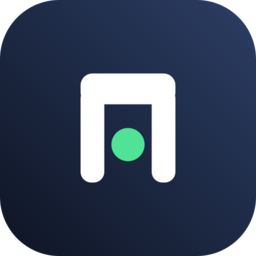
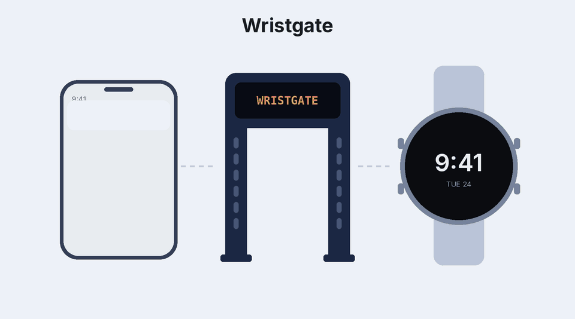
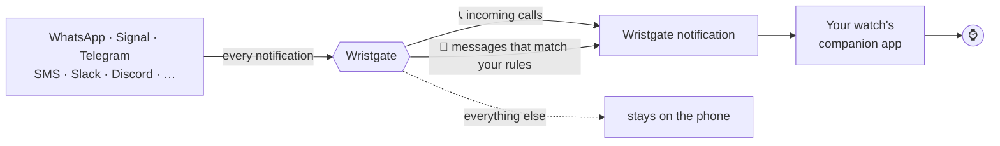
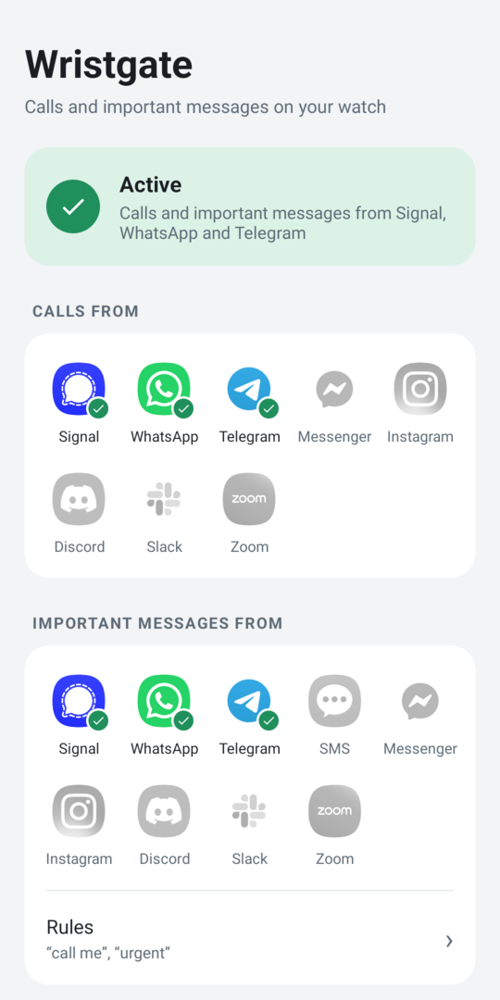
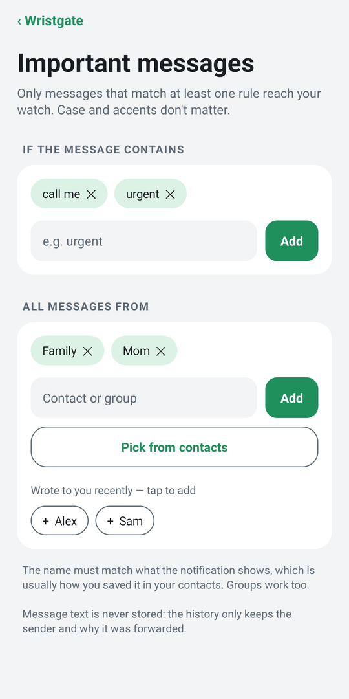
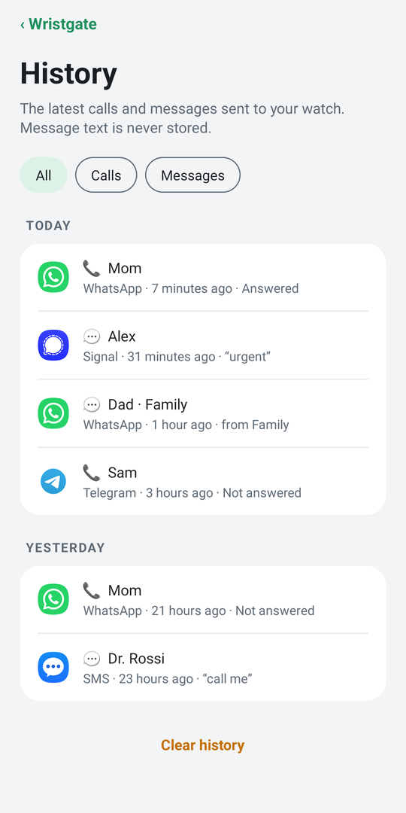
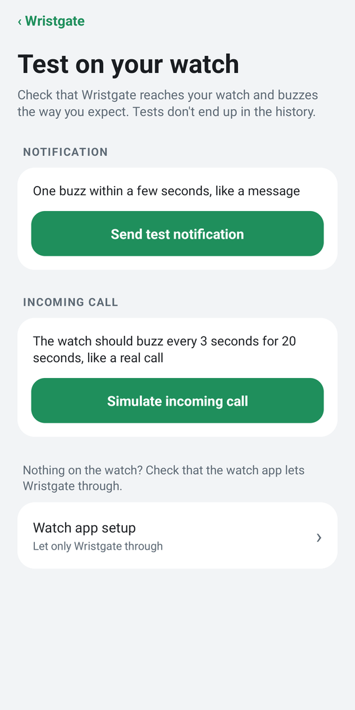

<p align="center">
  
</p>

<h1 align="center">Wristgate</h1>

<p align="center">
  <b>Only the calls and messages that matter reach your watch.</b><br>
  An Android app that sits between your messaging apps and your smartwatch, and lets through only what you choose.
</p>

<p align="center">
  
  <br><sub>Illustration of how it works, not a screen recording.</sub>
</p>

---

## Why

Smartwatch companion apps let you choose which phone apps may notify your wrist. The choice works **per app, all or nothing**:

- **Turn WhatsApp on**, and every group chat, meme and "👍" makes your wrist buzz.
- **Turn WhatsApp off**, and you miss the call from home and the one message that said *"urgent, call me"*.

Messaging-app calls (WhatsApp, Signal, Telegram…) are internet calls, not phone calls. On many watches they show up as ordinary app notifications, if at all, and not as a proper incoming call.

**Wristgate is the gate in between.** It reads your notifications on the phone and re-posts, as its own clean notification:

- 📞 **incoming calls** from the apps you pick;
- 💬 **important messages**: the ones that contain a keyword (*urgent*, *call me*…) or come from a person or group you chose.

Everything else stays on your phone.

A forwarded notification normally buzzes your watch only once. For calls, Wristgate sends a fresh notification every 3 seconds while the phone rings (up to a minute): *📞 Mom · WhatsApp · ringing for 6 s*. Your wrist keeps buzzing like it does for a real call, and the copies disappear from the watch as soon as you answer or decline.

## How it works



The key idea: **in your watch's companion app, Wristgate is the only one of these apps allowed through.** Wristgate does the sorting.

## Screenshots

<p align="center">
  
  &nbsp;
  
  &nbsp;
  
  &nbsp;
  
</p>

## Setup

1. **Install** `wristgate-x.y.z.apk` from [Releases](../../releases). Updates install over it, keeping your settings.

   <details><summary>Verify the APK (optional)</summary>

   Every release is signed with the same key. Its certificate SHA-256 fingerprint is:

   ```
   50:25:61:09:AB:A5:46:69:5B:91:7D:6E:77:67:16:91:CD:FA:6F:06:27:1E:C1:B9:EE:96:73:A0:78:9A:C2:F0
   ```

   Check it with `apksigner verify --print-certs wristgate-x.y.z.apk` (Android SDK build-tools).
   </details>

2. **Open Wristgate and grant the three permissions** it asks for:
   - *Notification access*, to see incoming calls and messages;
   - *Show notifications*, to post the copies your watch will receive;
   - *Unrestricted battery*, so Android doesn't stop it in the background (tap it, then choose **Unrestricted**).

   > On Android 13+, apps installed outside an app store get *notification access* greyed out. Go to **Settings → Apps → Wristgate → ⋮ → Allow restricted settings**, then try again.
3. **Pick your apps.** Tap the icons under *Calls from* and *Important messages from*: colored with a ✓ means on.
4. **Set your rules.** Open *Rules* and add keywords and/or contacts.
5. **In your watch's companion app** (Garmin Connect, Zepp, Galaxy Wearable, Fitbit, Huawei Health…), open the per-app notification settings:
   - ✅ **allow Wristgate**;
   - 🚫 **turn off the apps you selected in Wristgate**, or you'll get everything twice. Leave the other apps as they are.
6. Open **Test on your watch**. Tap **Send test notification**: it should show up on your watch within seconds. Then tap **Simulate incoming call**: your watch should buzz every 3 seconds for 20 seconds. If both work, you're done.

## Rules for important messages

A message reaches your watch if it matches **at least one** rule:

| Rule | Example | Notes |
|---|---|---|
| **Keyword** | `urgent`, `call me` | Case and accents don't matter: *URGENT* and *urgènt* both match. The defaults follow your phone's language. |
| **Contact or group** | `Mom`, `Family` | Every message from that person or group. Add them by typing, with **Pick from contacts**, or with one tap from **Wrote to you recently**. |

When you read the message on your phone, it also disappears from your watch.

## Supported apps

| App | 📞 Calls | 💬 Messages | On by default |
|---|:---:|:---:|:---:|
| Signal | ✓ | ✓ | ✓ |
| WhatsApp / WhatsApp Business | ✓ | ✓ | ✓ |
| Telegram / Telegram X | ✓ | ✓ | ✓ |
| SMS (Samsung Messages, Google Messages) | — | ✓ | |
| Messenger, Instagram | ✓ | ✓ | |
| Discord, Slack, Teams, Zoom | ✓ | ✓ | |
| Viber, LINE, Threema, Element, WeChat | ✓ | ✓ | |

Only installed apps are listed. Adding an app takes one line in [`Sources.kt`](app/src/main/java/io/github/federicogalli/wristgate/Sources.kt), and pull requests are welcome.

## Works with

Any watch or band whose phone companion app lets you choose **which phone apps** may send notifications. That's most of them.

**Tested so far:** Garmin Forerunner 265 with a Samsung Galaxy S20 Ultra (Android 13). If you try it with another watch, please [open an issue](../../issues) and tell us how it went.

## Privacy

- **No internet permission.** Wristgate cannot send anything anywhere; check [`AndroidManifest.xml`](app/src/main/AndroidManifest.xml).
- **Message text is never stored.** The on-screen history keeps only the sender, the app, the time and why it was forwarded (last 100 items).
- **No contacts permission.** *Pick from contacts* uses Android's system picker, which shares only the contact you choose.
- No ads, no analytics, no third-party libraries.

## Limitations

- The contact name must match what the notification shows. For WhatsApp, Signal and SMS that's usually your address book name. Some apps (Telegram, Instagram, Discord) may show the profile name instead: add those people from **Wrote to you recently**.
- Wristgate can only forward what the app actually shows as a notification. If you're using the phone, have the chat open, or WhatsApp Web/Desktop is active, the app often doesn't notify, so there's nothing to forward.
- Messages from **muted** chats and groups only appear in the app's silent summary notification, so Wristgate doesn't see them as messages.
- After Wristgate restarts, it only looks at messages from the last 2 minutes, so it never re-forwards old ones.
- Call and message detection relies on how each app builds its notifications. An app update can change that.
- Android 8.0 or newer.

## Build from source

Requirements: JDK 17+ and the Android SDK (platform 36). Android Studio is not needed.

```bash
./gradlew assembleDebug
adb install app/build/outputs/apk/debug/app-debug.apk
```

The app has no third-party dependencies, only Android system APIs. For debugging, `adb logcat -s Wristgate` shows what each app posts. Message content is never logged.

## Languages

The app is in English. The only translation so far is Italian, used when your phone is set to Italian. On Android 13+ you can pick the language per app in system settings. Translations are welcome: copy `app/src/main/res/values/strings.xml` into `values-<language>/` and translate it.

## License

[GPL-3.0](LICENSE). Wristgate is free software: you can use, study, share and improve it.

---

<p align="center">
  Made by <b>Federico Galli</b> · <a href="https://www.sideralis.org">sideralis.org</a>
</p>

<sub>Not affiliated with any watch or messaging company. All product names and trademarks belong to their owners. The demo animation is generated by <a href="docs/make_demo_gif.py"><code>docs/make_demo_gif.py</code></a>.</sub>
